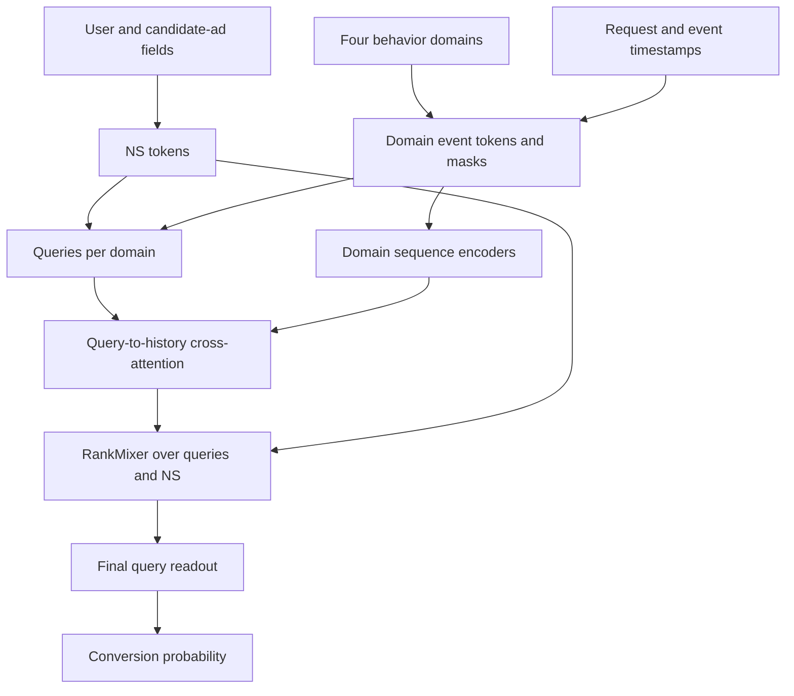
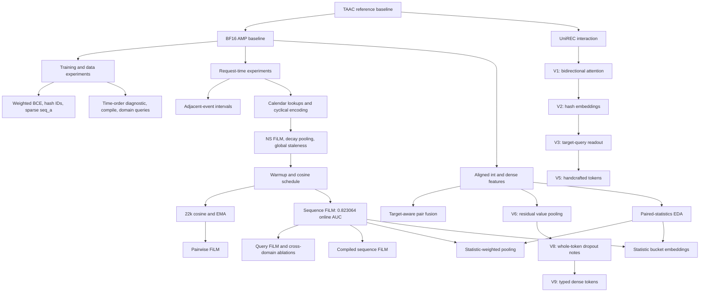

# Tencent Advertising Algorithm Competition 2026

We started from Tencent's PCVRHyFormer baseline and tested how to represent user history, request time, and paired user features for post-click conversion prediction. Our best recorded competition evaluation reached **0.823064 ROC-AUC** with time conditioning on sequence events.

## 1. Competition and data

This project uses the advertising conversion-prediction dataset from the 2026 Tencent Advertising Algorithm Competition (TAAC), held with KDD Cup 2026. The task is to estimate the probability that a user converts after clicking the candidate ad. The competition evaluates ranking with ROC-AUC and also imposes inference-latency constraints. [Competition site](https://algo.qq.com/) | [Dataset notes](docs/Dataset_description.md)

Tencent supplied anonymized advertising logs. The preliminary-round dataset is described as containing 200 million user behavior sequences. The model consumes flat Parquet columns and a companion `schema.json` containing feature IDs, field lengths, vocabulary sizes, and per-domain definitions. IDs are anonymized integers. List-valued fields capture multi-valued attributes, numeric vectors, or variable-length histories.

| Column family | Count | Format and role |
| --- | ---: | --- |
| IDs and target metadata | 5 | `user_id`, `item_id`, `label_type`, `label_time`, and `timestamp`. Training uses `label_type == 2` as the positive class. `timestamp` is the prediction-time reference, and `label_time` describes label timing. |
| User integer features | 46 | 35 scalar fields and 11 integer lists. List fids are 15, 60, 62–66, 80, and 89–91. |
| User dense features | 10 | Float lists. Fids 61 and 87 are embedding vectors. Fids 62–66 and 89–91 have a corresponding user integer field with matching positions. |
| Ad/item integer features | 14 | 13 scalar fields and one integer list (fid 11). |
| History fields | 45 | Variable-length integer lists across four behavior domains. A domain contains parallel event fields, including a timestamp field where defined by the schema. |
| **Total** | **120** | One row represents a labeled user–candidate-ad example with its available histories. |

| History domain | Feature IDs | Columns |
| --- | --- | ---: |
| A | 38–46 | 9 |
| B | 67–79, 88 | 14 |
| C | 27–37, 47 | 12 |
| D | 17–26 | 10 |

For an aligned pair such as fid 62, if the integer list is `[1, 2, 3]` and the dense list is `[10.5, 20.0, 15.5]`, the value `20.0` belongs to ID `2`. That relationship motivated several variants in [the version guide](#3-version-guide). Within a domain, the loader keeps event fields and timestamps aligned, pads or truncates the histories, and builds masks and request-relative age buckets before tokenization. [Data-to-tokens walkthrough](code/TAAC_baseline/DATA_TO_TOKENS_README.md)

## 2. Model architecture

PCVRHyFormer uses **non-sequence tokens** for static user and ad information, **event tokens** for the historical sequences, and **query tokens** to read each domain. The queries give each domain a compact representation for scoring while retaining access to its history through cross-attention.



1. **Static tokens.** Embed categorical fields and mean-pool valid IDs within multivalue fields. The RankMixer tokenizer concatenates field embeddings, then chunks and projects them into a fixed set of user and item tokens. A separate projection creates the user-dense token. The group-based tokenizer is also available.
2. **Event tokens.** For each domain, concatenate per-field embeddings at each event, project to the model width, and add an embedding for the bucketed request-to-event time difference. Masks exclude padded positions from attention.
3. **Query generation.** Concatenate flattened NS tokens with a masked pooled history for each domain. Feed-forward networks produce a small set of queries conditioned on both the candidate and that history.
4. **Stacked HyFormer blocks.** Each block encodes the domains separately and cross-attends from each query group to its own encoded sequence. RankMixer concatenates those queries with the NS tokens, exchanges channel groups across tokens by reshaping and transposing, applies a token-wise FFN, and splits the outputs for the next block. With full RankMixer, the hidden width must be divisible by `queries across all domains + NS tokens`. The reference launcher uses two blocks, four attention heads, width 64, and 16 combined tokens with the standard schema.
5. **Prediction and training.** Flatten and project the final queries, then produce one conversion logit. Sigmoid converts it to a probability. The baseline trains with BCE with logits and uses AdamW for dense parameters and Adagrad for embeddings. Validation tracks ROC-AUC and log loss. [Reference baseline](code/TAAC_baseline/)

**Best-performing time design.** The highest-scoring run added a cyclical request-time representation built from daily and weekly sine/cosine inputs. An embedding of the smallest nonzero event-age bucket summarizes global user staleness. We used the resulting time representation to generate FiLM scale and shift vectors and apply them to both NS tokens and event tokens. For query generation, learned per-domain decay weights give recent events more influence over each pooled history. Training used BF16 AMP, warmup and cosine decay, and disabled EMA. [Sequence-FiLM configuration](code/baseline_film_decay_staleness_cosine_film_on_seq/)

## 3. Version guide

Start with the reference baseline for the shared backbone, the AMP baseline for training-only comparisons, or sequence FiLM for the best recorded score. The diagram groups snapshots by design question. Arrows show comparison paths and shared ideas. The tables link to each snapshot and its run notes.



### Reference and training experiments

| Snapshot | What it tests |
| --- | --- |
| [TAAC baseline](code/TAAC_baseline/) | Original PCVRHyFormer and Parquet pipeline. |
| [AMP baseline](code/baseline_train_amp/) | BF16 and FP16 autocast with the dual-optimizer training loop. |
| [Positive-weight BCE](code/baseline_amp_bce_loss_weight/) | Gives rare conversions more weight in the loss when enabled. |
| [Hash embeddings](code/baseline_amp_hash_embedding/) | Recovers some signal from high-cardinality sequence IDs using a shared table. |
| [Sparse seq_a](code/baseline_amp_seq_a/) | Compacts active events within the loaded history before applying the sparse cap. |
| [Timestamp diagnostics](code/Timestamp_Split_Baseline_AMP/) | Checks row-group timestamp ranges and retains the physical split. |
| [Per-domain queries](code/baseline_amp_per_seq_queries_exp/) | Reallocates a fixed query budget among domains. |
| [AMP compile](code/baselin_amp_compile/) | Benchmarks optional compilation on the AMP base. |

### UniRec experiments

| Snapshot | What it tests |
| --- | --- |
| [V1](code/UniRec_V1/) | Bidirectional NS/sequence attention, sparse history compaction, and weighted loss. The launcher defaults to HyFormer unless `--block_type unirec` is passed. |
| [V2](code/UniRec_V2/) | Field-specific hash embeddings for large sequence vocabularies. |
| [V3](code/UniRec_V3/) | Domain queries read updated sequence and NS features, and an item query reads the final domain queries. |
| [V5](code/UniRec_V5/) | Three added tokens for activity, history coverage, and candidate category match. |
| [V6](code/UniRec_V6/) | A separate AMP branch for residual value-conditioned pooling of aligned features. |
| [V9](code/UniREC_v9/) | Dedicated dense tokens for embedding, statistic, and quantile fields, with typed pair fusion and token dropout. |

[V8 dropout notes](code/UniREC_v9/V8_CHANGES.md) are included in the V9 folder. V4, V7, and V8 have no standalone snapshots here.

### Time and aligned-feature experiments

| Snapshot | What it tests |
| --- | --- |
| [Adjacent-event intervals](code/baseline_amp_time_interval_feature/) | Each event gets an embedding of its gap from the preceding event. |
| [Discrete request time](code/baseline_amp_time_feature/) | Calendar lookup embeddings form a time NS token. |
| [Cyclical request time](code/baseline_time_periodic/) | Sine/cosine encoding gives continuity across calendar boundaries. |
| [NS FiLM, decay, and staleness](code/basel_amp_FiLM_decay_pool_user_staleness/) | Uses request time and the age of the latest activity to condition NS and recency-weight domain summaries. |
| [22k cosine and EMA](code/baseline_amp_FiLM_decay_pool_staleness_cosine_lr22k_ema999/) | Tests the learning-rate schedule and smoothed weights. |
| [Sequence-FiLM control](code/baseline_film_decay_staleness_cosine_film_on_seq/) | Extends time FiLM to event tokens. Best recorded online AUC. |
| [Time ablations](code/baseline_amp_with_sincos_time_feature/) | Tests FiLM on generated queries, cross-domain attention, and alternative recency summaries. |
| [Compiled sequence FiLM](code/model823_compile/) | Tests throughput using compilation, TF32, and fewer device synchronizations. |
| [Aligned pair fusion](code/baseline_amp_pair_feature_fusion/) | Uses candidate-aware pooling and extra tokens for aligned values. |
| [Pairwise FiLM](code/baseline_v2_pairwise_FiLM/) | Makes paired numeric values modulate their matching ID embeddings. |
| [Weighted pair pooling](code/baseline_pair_stat_weighted_pool/) | Uses signed-log statistics to weight ID embeddings. |
| [Pair bucket embeddings](code/baseline_pair_stat_bucket_emb/) | Represents non-monotonic effects by embedding statistic buckets. |
| [Paired-statistics EDA](code/eda_pair_stats/) | Profiles paired values and conversion by quantile to inform the pooling and bucket experiments. |

### Running a snapshot

Use the competition Parquet files and matching `schema.json`. The snapshots use Python, PyTorch, NumPy, PyArrow, scikit-learn, and TensorBoard. The default AMP launchers target CUDA with BF16 support. Start with a small matched data subset when checking a configuration.

```bash
cd code/baseline_film_decay_staleness_cosine_film_on_seq
export TRAIN_DATA_PATH=/path/to/training-parquet-and-schema
export TRAIN_CKPT_PATH=/path/to/checkpoints
export TRAIN_LOG_PATH=/path/to/logs
export TRAIN_TF_EVENTS_PATH=/path/to/tensorboard-events
bash run.sh
```

Use the snapshot's own `infer.py` where provided. The sequence-FiLM inference entry point takes `MODEL_OUTPUT_PATH`, `EVAL_DATA_PATH`, and `EVAL_RESULT_PATH` and writes `predictions.json`. Keep the checkpoint with its schema and saved training configuration. V2 and V3 expose `train.py` directly. Evaluation requires the competition data and a compatible checkpoint from the original run or a new training run.

## 4. Results

The team’s best recorded competition-platform evaluation was **0.823064 online ROC-AUC** on **May 14, 2026** (eval task **94016**). The corresponding run reported **0.865654 peak validation ROC-AUC** at step **10,854**. These values describe different evaluation datasets. [Recorded run and checkpoint details](code/baseline_film_decay_staleness_cosine_film_on_seq/#result)

| Reported milestone | Online ROC-AUC |
| --- | ---: |
| UniRec V2, earliest scored run in the history | 0.8130 |
| Historical BF16 AMP run | 0.8137 |
| Basic request-time features | 0.8142 |
| Time token with channel-wise gate | 0.8146 |
| NS FiLM and time-decay pooling | ≈0.8150 |
| Add global user staleness | 0.8194 |
| Warmup and cosine schedule, before EMA | 0.8212 |
| 22k schedule with EMA 0.999 | 0.8198 |
| **Sequence FiLM, 30k schedule with EMA disabled** | **0.823064** |
| Extend FiLM to queries | 0.8213 |
| Pair-stat weighted pooling | 0.821803 |
| Pairwise FiLM with the EMA recipe | 0.811552 |

The best recorded score was about **0.0101 AUC** higher than the earliest recorded score. Global staleness had the largest increase in the logged time-feature progression. Several milestones also changed training settings, so the score differences are historical observations. [Experiment history](code/baseline_film_decay_staleness_cosine_film_on_seq/#cumulative-experiment-chain-how-we-got-here) | [Paired-stat run notes](code/baseline_pair_stat_weighted_pool/) | [Experiment spreadsheet](https://docs.google.com/spreadsheets/d/1b5rW61si_EmfvenNPMOT2MAxjlm35DVz5sKaIOBqSeE/edit?usp=sharing)

## 5. Limitations and next steps

| Limitation | Next experiment |
| --- | --- |
| The held-out set is based on Parquet row-group order. Monotonic group maxima alone cannot establish a time-disjoint split. | Create explicit cutoffs using prediction timestamps, check event and label availability at the cutoff, and evaluate over several forward-in-time windows. |
| Some promising time experiments changed feature placement, learning-rate duration, and EMA together. | Use a fixed split and checkpoint policy for matched ablations of staleness, pooling, NS FiLM, and event FiLM. Repeat with several seeds and report variation. |
| The sequence cap discards some history, and age buckets give a coarse representation of elapsed time. | Compare schema-aware compaction and exact elapsed-time decay with bucket-based decay at matched sequence budgets. |
| Large vocabularies cost memory. Skipping fields loses signal, and hashing can combine unrelated IDs. | Compare field-specific hashes and frequency-based vocabulary cutoffs, and measure collision rates, memory, speed, and AUC. |
| Treating paired numeric values as monotonic pool weights reduced the recorded online AUC. | Fit bucket boundaries on the training split and test value embeddings and candidate-aware pooling over the same control, with checks by feature group. |
| AUC measures ranking. The documented compile and performance experiments have limited runtime measurements. | Track log loss and calibration alongside ROC-AUC. Measure training throughput, memory, and inference latency together under the same hardware and batch settings. |
